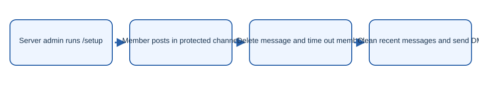

# Spam Tracker

Discord moderation bot that uses a honeypot channel to detect and clean up spam.

## What it does

- Run `/setup` to create a protected channel.
- Messages posted there are deleted; the sender may receive a two hour timeout.
- The bot deletes that user’s recent tracked messages across the server and sends a DM with a timeout removal button.
- Moderators can run `/remove user` to clean recent messages.

## Getting started

Copy `.env.example` to `.env`, set `DISCORD_TOKEN`, `CLIENT_ID`, `DATABASE_URL`, and a unique `ADMIN_PASSWORD`, then run `npm install`, `npm run prisma:push`, `npm run deploy-commands`, and `npm run dev`.

## Security

Keep credentials in local environment files. The example files contain placeholders only. Rotate any credential previously used in a local deployment before publishing or redeploying.
